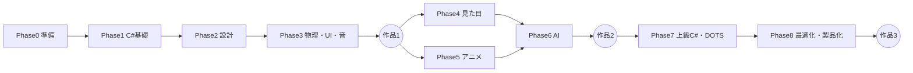

# Unity ROADMAP

## UEとUnityの用語対応

| UE | Unity |
|---|---|
| Level | Scene |
| Actor | GameObject |
| Component | Component（MonoBehaviourなど） |
| Blueprint Class | Prefab + C#スクリプト |
| Content Browser | Project ウィンドウ |
| World Outliner | Hierarchy |
| Details Panel | Inspector |
| Event Tick | `Update()` |
| BeginPlay | `Awake()` / `Start()` |
| Event Dispatcher | `event` / `Action` / `UnityEvent` |
| DataAsset | ScriptableObject |
| Enhanced Input | Input System |
| Niagara | Particle System / VFX Graph |
| Material | Material + Shader Graph |
| Animation Blueprint | Animator Controller |
| Behavior Tree | Unity Behavior（パッケージ）/ 自作FSM |
| Sequencer | Timeline |
| Fab | Asset Store |
| World Partition | Addressables + シーン分割 |

## 全体像

## Phase 0：準備

| 分野 | 小項目 | UE対応 |
|---|---|---|
| 辞書 | Unity基本用語集（UE同義語つき） | 用語集 |
| 概要 | Unityとは / ゲーム開発の流れ / 調べ方（公式Manual・Scripting API・フォーラム）とAIの使い方 | 概要 |
| 環境 | Unity Hub / エディタのインストール / ◆**テンプレート選択（3D (URP) / 2D (URP)）** / 再生と停止 / エディタ言語 | 環境 |
| エディタ基礎 | Scene・GameObject・Component / ウィンドウ名（Hierarchy・Inspector・Project・Scene・Game・Console）/ レイアウト操作 | エディタ基礎 |
| 操作 | シーンビューのカメラ / Transform（移動・回転・拡大）/ スナップ・Pivot / Local・Global | 操作 |
| アセット | Mesh / Sprite / Material / Texture の基本 / ◆**.metaファイルの役割** | アセット |
| Prefab | **Prefab / Nested Prefab / Prefab Variant** | BPクラスの一部 |
| 素材入手 | Asset Storeの使い方・ライセンス / Package Manager | Fab |
| 実践 | 簡単な部屋をプリミティブとアセットで作る | カフェ部屋 |
| 開発環境 | ◆**IDE構築（Rider / Visual Studio / VS Code）+ Unity連携** | ― |
| バージョン管理 | **Git + Git LFS**（`Library` `Temp` `Logs` `UserSettings` `obj` `Builds` を除外 / `.meta`は必ずコミット / Asset Serializationは Force Text） | Git |
| 便利技 | ショートカット一覧 / ◆Undo・Play中の変更が戻る問題 | ショートカット |

## Phase 1：C#基礎

| 分野 | 小項目 | UE対応 |
|---|---|---|
| 最初の一歩 | ◆**C#スクリプトを作ってアタッチ** / `Debug.Log` / `MonoBehaviour` | 文字表示 |
| ライフサイクル | `Awake` / `Start` / `Update` / `FixedUpdate` / `LateUpdate` / `OnEnable` / `OnDisable` / `OnDestroy` / `Time.deltaTime` | BeginPlay・Tick |
| 変数 | 型（int / float / bool / string / Vector3）/ `public`と`[SerializeField]` / Inspectorで調整 / 命名規則 | 変数 |
| 制御構文 | if / switch / for / foreach / while | Branch・ループ |
| 関数 | メソッド / 引数・戻り値 / 可視性 | 関数 |
| 参照 | `GetComponent` / Inspectorでの参照 / `Find`系（非推奨の理由）/ `TryGetComponent` | 参照・Cast |
| 型変換 | `as` / `is` / パターンマッチ | CastTo |
| アクタ実践 | 移動・回転・`Instantiate`（スポーン）/ `Destroy` | 移動・回転・スポーン |
| データ構造 | **配列 / `List<T>` / `Dictionary<K,V>` / `HashSet<T>`** | Array・Map・Set |
| 型定義 | **`struct` / `enum` / `class`の違い（値型・参照型）** | 構造体・Enum |
| クラス設計 | クラス / 継承 / `abstract` / `virtual` / `override` / **`interface`** | クラス継承・BP Interface |
| イベント | **`event` / `Action` / `UnityEvent`** | Event Dispatcher |
| 時間制御 | **Coroutine（`WaitForSeconds`）/ `Invoke`** | Timeline・Delay |
| 補間 | **`Lerp` / `Mathf` / AnimationCurve** | Timeline |
| デバッグ | `Debug.Log` / `Debug.DrawRay` / ブレークポイント（IDEアタッチ）/ Console / Gizmos | Print String・BP |
| エラー | コンパイルエラーの読み方 / NullReferenceExceptionの直し方 | コンパイルエラー |
| 実践 | ライトON/OFF / 往復移動ステージ / シューティング（的の移動→生成→スコア→タイマー） | 実践群 |

## Phase 2：ゲーム設計

| 分野 | 小項目 | UE対応 |
|---|---|---|
| 構成の考え方 | ◆**GameObject＋Component指向（継承より合成）** | コンポーネント指向 |
| 入力 | **Input System**（Action Map / PlayerInput / Rebinding） | Enhanced Input |
| キャラ操作 | **CharacterController** と **Rigidbody** 方式 / 移動・ジャンプ・カメラ追従 | Pawn・Character |
| カメラ | **Cinemachine**（Virtual Camera・Follow・Look At・ブレンド） | PlayerCamera |
| ゲーム進行 | GameManager的な管理クラス / ステート管理（enum・ステートパターン）/ ◆**Singletonの使いどころと注意** | GameMode |
| シーン | `SceneManager` / シーン遷移 / Additive Scene | レベル遷移 |
| データ保持 | `DontDestroyOnLoad` / static / ScriptableObject | GameInstance |
| セーブ | **JSON（`JsonUtility`）/ `PlayerPrefs`の限界 / `Application.persistentDataPath`** / ハイスコア | SaveGame |
| データ駆動 | **ScriptableObject（設定・アイテムDB）/ CSV・JSON読み込み** | DataAsset・DataTable |
| 識別 | **Tag / Layer / enumによる識別** | Gameplay Tags |
| 設計整理 | ◆**Object Pooling** / ◆**依存関係の整理（循環参照を避ける）** | 設計まとめ |
| 参考 | ScriptableObjectアーキテクチャ（Ryan Hipple氏の講演）| ― |

## Phase 3：物理・UI・音

| 分野 | 小項目 | UE対応 |
|---|---|---|
| 衝突 | Collider（Box / Sphere / Capsule / Mesh）/ Rigidbody / `isTrigger` | コリジョン |
| 衝突判定 | `OnCollisionEnter` / `OnTriggerEnter` / `OnTriggerExit` | Hit・Overlap |
| 衝突設定 | **Layer Collision Matrix / Physics Material** | コリジョンプリセット |
| 物理 | **Raycast / SphereCast / OverlapSphere** / ForceとImpulse / Joint | Line Trace・Chaos |
| 衝突実践 | アイテム取得 / ダメージ床・炎 | アイテム・火 |
| UI基礎 | **Canvas / uGUI / TextMeshPro** / Button・Image・Slider | UMG |
| UIレイアウト | RectTransform・アンカー / Layout Group（Vertical・Horizontal・Grid）/ Canvas Scaler | CanvasPanel・Box類 |
| UI連携 | スクリプトからUI更新 / `onClick`イベント / イベントでUIを更新 | バインディング |
| UIの発展 | **UI Toolkit**（UXML / USS）入門 | CommonUI |
| UI実践 | コイン枚数 / HPバー / メニュー画面 | UI実践 |
| 音の基礎 | **AudioClip / AudioSource / AudioListener** / 3Dサウンド（減衰）| サウンドウェーブ・減衰 |
| 音の管理 | **Audio Mixer**（BGM・SE・Voiceのグループ化、音量調整）| サウンドクラス |
| 音の実践 | BGM / 音量変更・切替 / 取得SE / 爆発・UI音 / ループ音（火）| 音の実践 |

## 作品1：アクションゲーム（3D）

| ステップ | 内容 |
|---|---|
| 準備 | プロジェクト作成（3D URP）/ アセット導入 |
| ステージ | 環境作り / 落下ギミック / 上下移動ギミック / 夜環境 |
| ゲーム要素 | コイン / タイマー（分:秒）/ ライフ |
| 進行 | リスタート / クリア / シーン遷移 / セーブ |
| 画面 | 開始演出 / タイトル / ステージ選択 / ゲームオーバー |
| 仕上げ | ビルドして容量確認 / 完成とプレイ |

## Phase 4：見た目

| 分野 | 小項目 | UE対応 |
|---|---|---|
| レンダリング基礎 | ◆**URP（Universal Render Pipeline）の仕組み / Built-in・HDRPとの違い** | ― |
| マテリアル | Material / PBR / Texture設定 / **Shader Graph**（ノードで作る）/ Material Property Block | マテリアル |
| ライティング | Directional / Point / Spot / **Baked・Realtime・Mixed** / Light Probe / Reflection Probe / **Adaptive Probe Volumes** / Skybox | ライティング |
| ジオメトリ | LOD Group / ◆**GPU Resident Drawer** / **Terrain**（地形・樹木）/ ProBuilder | Nanite・Landscape |
| VFX | **Particle System（Shuriken）/ VFX Graph** / 爆発・炎・魔法の実践 | Niagara |
| 演出 | **Timeline / Playable Director** / Cinemachineでカットシーン | Sequencer |
| 画作り | **Volume + Post-processing**（Bloom・Color Adjustments・Depth of Field・Vignette）| ポストプロセス |

## Phase 5：アニメーション

| 分野 | 小項目 | UE対応 |
|---|---|---|
| 基礎 | Animation Clip / Avatar / Humanoid・Generic / Rig設定 | Skeletal Mesh |
| 制御 | **Animator Controller / ステートマシン / Parameter / Transition** / **Blend Tree** | AnimBP・Blend Space |
| 再生 | `Animator.Play` / Layer・Avatar Mask / **Animation Event** | Montage・Notify |
| 流用 | **Humanoidリターゲット**（Avatar共通化）| リターゲット |
| IK | **Animation Rigging（Two Bone IK・Multi-Aim）/ Foot IK** | Control Rig |
| 手付け | Animation Window でのクリップ作成 / Timeline連携 | ― |

## Phase 6：AI

| 分野 | 小項目 | UE対応 |
|---|---|---|
| 経路探索 | **AI Navigation（NavMesh Surface・NavMeshAgent・NavMeshObstacle）** | NavMesh |
| 状態管理 | **ステートマシンを自作（enum / ステートパターン）** | State Tree |
| 思考 | **Unity Behavior**（パッケージ）/ Behavior Treeの考え方 | Behavior Tree |
| 知覚 | `Physics.OverlapSphere` + 視野角判定 + Raycast（視覚）/ 距離（聴覚）| AI Perception |
| 判断 | スコアリング / Utility AI | EQS |
| 発展（任意） | **ML-Agents**（強化学習）| ― |

## 作品2：敵が襲ってくる3Dゲーム

| 使う要素 | 内容 |
|---|---|
| Phase 4 | Shader・ライト・VFXで見た目を作る |
| Phase 5 | プレイヤー・敵のAnimator |
| Phase 6 | 敵AI（巡回→発見→追跡→攻撃）|
| 総合 | UI・セーブ・音まで含めて1本完成 |

## Phase 7：上級C#・DOTS

| 分野 | 小項目 | UE対応 |
|---|---|---|
| 言語機能 | **ジェネリクス / `delegate` / `Func` / `Action` / LINQ（GC注意）** | C++基本 |
| 非同期 | **`async/await` / `Awaitable`（Unity 6）/ UniTask / Coroutineとの使い分け** | ― |
| 構造化 | **Assembly Definition（asmdef）/ Namespace / 名前空間設計** | モジュール |
| メモリ | **GCの仕組み / `struct` / `Span<T>` / ボックス化** | GC・スマートポインタ |
| 設計 | **DI（VContainer / Zenject）/ MVP・MVVMパターン / Service Locator** | ― |
| エディタ拡張 | **カスタムInspector / PropertyDrawer / EditorWindow / ScriptableWizard** | ― |
| 読み込み | **Addressables**（非同期ロード・メモリ管理）| 非同期ロード |
| DOTS | **ECS / Jobs System / Burst Compiler** / Entities Graphics | Mass |
| 発展 | ◆**Ability System（自作）/ Scriptable Object Ability** | GAS |
| 読解 | UnityCsReference（GitHub）を読む | UEソース |
| テスト | **Unity Test Framework（EditMode / PlayMode）** | ― |

## Phase 8：最適化・製品化

| 分野 | 小項目 | UE対応 |
|---|---|---|
| 計測 | **Profiler / Frame Debugger / Memory Profiler / Profile Analyzer** | stat unit・Insights |
| CPU | **GC Alloc削減 / Update削減 / キャッシュ / Job化** | ― |
| 描画 | **SRP Batcher / GPU Instancing / Static Batching / Occlusion Culling / Draw Call削減** | Nanite制限・LOD |
| 大規模 | **Addressables / シーン分割 / Streaming** | World Partition |
| ネットワーク | **Netcode for GameObjects / Mirror / Fish-Net**（Server・Client・RPC・NetworkVariable）| Replication |
| サービス | **Unity Gaming Services**（Cloud Save・Authentication・Leaderboards）| ― |
| 出荷 | ビルド設定 / **IL2CPP / Mono** / 各プラットフォーム設定 / 容量削減 | パッケージ化 |

## 作品3：自分のゲーム

| 内容 |
|---|
| 企画から公開まで1本。ゲームジャム（Ludum Dare / Unityroom Jam など）参加もアリ |

## 2Dゲームを作りたい場合の追加ルート

Unityは2Dが強いから、2D志向ならPhase 4・5をこっちに差し替えてね。

| 分野 | 小項目 |
|---|---|
| 素材 | Sprite / Sprite Editor / Sprite Atlas / Pixel Perfect Camera |
| マップ | **Tilemap / Rule Tile / Tile Palette** |
| 物理 | Rigidbody2D / Collider2D / Composite Collider / Effector2D |
| アニメ | Sprite Animation / **2D Animation（ボーン）/ 2D IK** |
| ライト | **2D Light（URP 2D Renderer）** |
| カメラ | Cinemachine 2D / Confiner |
