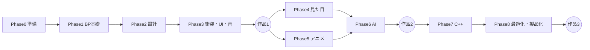

# Unreal Engine ROADMAP

## 全体像

## Phase 0：準備

| 分野 | 小項目 | 出典 |
|---|---|---|
| 辞書 | UE5基本用語集（Unity同義語つき）**※巻末から最初へ移動** | 既存155 |
| 概要 | UE5とは / ゲーム開発の流れ / 調べ方3つとChatGPTの使い方 | 既存03, 04, 06 |
| 環境 | DL方法 / プロジェクト作成と設定 / 再生と停止 / エディタが重い時 / 日英切替 | 既存08〜12 |
| エディタ基礎 | レベル・アクタなど基本用語 / 全体図とウィンドウ名 / レイアウト操作 | 既存14〜16 |
| 操作 | ビューポートのカメラ / アクタ操作・トランスフォーム・スナップ・ピボット | 既存17〜20 |
| アセット | スケルタル／スタティックメッシュ / アクタ詳細設定 / アクタの種類 | 既存21〜23 |
| ブラウザ類 | コンテンツブラウザ（追加・操作・表示・フォルダ構成）/ 保存とレベル操作 / アウトライナー / 詳細パネル / コンポーネント / ビューポート表示設定 | 既存24〜31 |
| 実践 | カフェっぽい部屋を作る | 既存32 |
| 素材入手 | **Fabの使い方・ライセンス・Megascans（旧マーケットプレイスと統合）** | 既存33+34 |
| 便利技 | ショートカット一覧 / 自動保存から復元 | 既存156, 157 |
| バージョン管理 | **Git + Git LFS導入**（`Binaries` `Intermediate` `Saved` `DerivedDataCache` を除外） | ★ |
| 任意 | UE4とUE5の違い（優先度低） | 既存05 |

## Phase 1：Blueprint基礎

| 分野 | 小項目 | 出典 |
|---|---|---|
| 概要 | BPとC++の関係 / BPとは・制作の流れ | 既存36, 37 |
| 最初の一歩 | 文字表示 / BeginPlay・Tick・フレーム / レベルBPとBPクラス | 既存38〜40 |
| アクタ実践 | 移動・回転・スポーン | 既存41〜43 |
| エディタ | BPエディタの使い方 / ノード名称と操作 / 整理（コメント・整列・折り畳み）/ blueprintUE | 既存44, 54〜56 |
| 変数 | 変数とは / String / Integer / Float / Boolean+Branch / HP実装 / 型の選び方 / 命名規則 / 作り方まとめ | 既存45〜52 |
| 変数の発展 | **配列（Array）/ Map / Set** | ★ |
| データ構造 | **構造体（Struct）/ 列挙型（Enum）** | ★ |
| ノード一覧 | 基本 / 計算・ランダム / 分岐・比較 / アクタ操作 / 繰り返し・順番 | 既存58〜62 |
| 調べ方 | BPの組み方・調べ方 / コンパイルエラー対処 / ノードの色と構造 | 既存57, 64, 65 |
| 部品化 | カスタムイベント / 関数 | 既存66, 67 |
| 部品化の発展 | **マクロ / Event Dispatcher / Blueprint Interface** | ★ |
| 参照 | 参照 / CastTo | 既存68, 69 |
| 時間制御 | **Timeline / Delay・Timer** | ★ |
| デバッグ | **Print String / ブレークポイント / Watch / Output Log** | ★ |
| 実践 | ライトON/OFF / 往復移動ステージ / シューティング(1)〜(4) | 既存53, 63, 70〜73 |

## Phase 2：ゲームフレームワーク

| 分野 | 小項目 | 出典 |
|---|---|---|
| クラス基礎 | クラスとは / 親子・継承 / 主要BPクラス紹介 | 既存75〜77 |
| ゲーム構成 | Actor / GameModeBase(1)(2) / Pawn / Character / PlayerController | 既存78〜83 |
| 入力 | **Enhanced Input（旧Inputの代わり）** | ★（既存84を差し替え） |
| キャラ実践 | キャラを1から作成(1)(2) | 既存85, 86 |
| データ保持 | GameInstance / SaveGame / ハイスコア | 既存87〜89 |
| 設計整理 | ゲームモードとレベルBPの違い / BPによるゲーム設計まとめ | 既存90, 91 |
| 設計の発展 | **Gameplay Tags / DataTable / DataAsset / Subsystem / コンポーネント指向設計** | ★ |

## Phase 3：衝突・UI・音

| 分野 | 小項目 | 出典 |
|---|---|---|
| 衝突 | コリジョンとは / メッシュに追加 / プリセット(1)(2) / Hit / BeginOverlap・EndOverlap | 既存93〜98 |
| 衝突の発展 | **Line Trace・Sphere Trace / 物理（Chaos）基礎** | ★ |
| 衝突の実践 | アイテム取得 / ダメージ火 | 既存99, 100 |
| UI基礎 | UIとは / UMGテキスト / プレイボタン / ウィジェットBPエディタ / 主なウィジェット | 既存102〜106 |
| UIレイアウト | CanvasPanel・アンカー / Text・Image・Button / Vertical・Horizontal・Overlay / Grid・WrapBox | 既存107〜110 |
| UI連携 | バインディング / IsVariable | 既存111, 112 |
| UIの発展 | **CommonUI入門（ゲームパッド対応）** | ★ |
| UI実践 | コイン枚数 / HPバー(1)(2) / メニュー画面(1)〜(3) | 既存113〜118 |
| 音の基礎 | 5つの鳴らし方 / インポート / サウンドウェーブ / サウンドキュー / 減衰 | 既存120〜124 |
| 音のBP | BPから鳴らす / 基本ノード15個 / サウンドノード12個 | 既存125〜127 |
| 音の実践 | BGM / 音量変更・切替 / 取得SE / 爆発・UI音 / 火の音+Audioコンポーネント | 既存128〜132 |

## 作品1：アクションゲーム（第9章そのまま）

| ステップ | 内容 | 出典 |
|---|---|---|
| 準備 | チュートリアル紹介 / プロジェクトとアセット | 既存134, 135 |
| ステージ | 環境作り(1)(2) / 落下ギミック / 上下移動ギミック / 夜環境 | 既存136〜138, 143, 144 |
| ゲーム要素 | コイン / タイマー / ライフ | 既存139, 140, 147 |
| 進行 | リスタート / クリア / レベル遷移 / セーブ | 既存141, 142, 145, 146 |
| 画面 | 開始演出 / タイトル / ステージ選択 / ゲームオーバー | 既存148〜151 |
| 仕上げ | 容量削減パッケージ化 / 完成とプレイ | 既存152, 153 |

## Phase 4：見た目

| 分野 | 小項目 | 出典 |
|---|---|---|
| マテリアル | マテリアルエディタ / PBR基礎 / パラメータ化 / **Material Instance** / Material Function / 動的マテリアル | ★ |
| ライティング | ライトの種類 / **Lumen** / シャドウ / Sky・Fog・Exposure | ★ |
| ジオメトリ | **Nanite** / LOD / Landscape・Foliage | ★ |
| VFX | **Niagara**（Emitter・System・Module）/ 爆発・炎・魔法の実践 | ★ |
| 演出 | **Sequencer**（カットシーン）/ カメラワーク | ★ |
| 画作り | **ポストプロセス** / カラーグレーディング | ★ |

## Phase 5：アニメーション

| 分野 | 小項目 | 出典 |
|---|---|---|
| 基礎 | Skeletal Mesh / Skeleton / Socket | ★ |
| 制御 | **Animation Blueprint** / ステートマシン / **Blend Space** | ★ |
| 再生 | **Montage**（攻撃・リロード）/ Anim Notify | ★ |
| 流用 | リターゲット（IK Retargeter） | ★ |
| IK | **Control Rig** / Foot IK | ★ |

## Phase 6：AI

| 分野 | 小項目 | 出典 |
|---|---|---|
| 基盤 | AIController / **NavMesh** / MoveTo | ★ |
| 思考 | **Behavior Tree + Blackboard** / Task・Decorator・Service | ★ |
| 知覚 | **AI Perception**（視覚・聴覚）| ★ |
| 判断 | **EQS** / **State Tree** | ★ |

## 作品2：敵が襲ってくる3Dゲーム

| 使う要素 | 内容 |
|---|---|
| Phase 4 | マテリアル・ライト・VFXで見た目を作る |
| Phase 5 | キャラ・敵のアニメーション |
| Phase 6 | 敵AI（巡回→発見→追跡→攻撃） |
| 総合 | UI・セーブ・音まで含めて1本完成させる |

## Phase 7：C++

| 分野 | 小項目 | 出典 |
|---|---|---|
| 環境 | Rider / Visual Studio構築 / Live Coding | ★ |
| 基本 | `UCLASS` `UPROPERTY` `UFUNCTION` マクロ | ★ |
| 連携 | **BPとC++のハイブリッド設計**（基盤C++、調整BP）| ★ |
| メモリ | ガベージコレクション / スマートポインタ | ★ |
| 通信 | **デリゲート**（BPのEvent Dispatcher相当）| ★ |
| 発展 | **Gameplay Ability System** | ★ |
| 読解 | UEソースコードを読む（EpicのGitHub連携）| ★ |

## Phase 8：最適化・製品化

| 分野 | 小項目 | 出典 |
|---|---|---|
| 計測 | `stat unit` / `stat fps` / **Unreal Insights** | ★ |
| 軽量化 | LOD / Nanite制限 / テクスチャ・ドローコール削減 | ★ |
| 大規模 | **World Partition** | ★ |
| 通信 | **ネットワーク**（Replication・RPC基礎）| ★ |
| 出荷 | パッケージ化 / 設定・プラットフォーム対応 | ★ |
