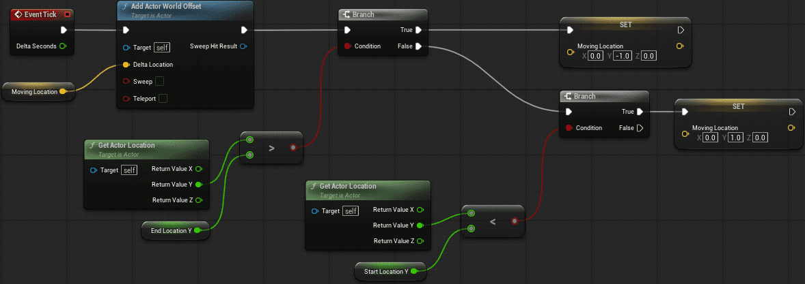
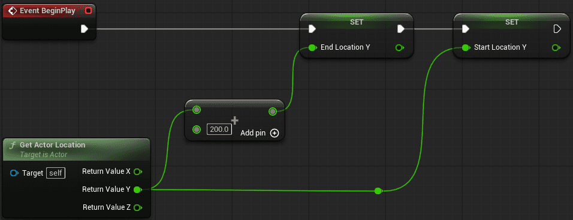

# 58 - 63

## Chapter 63

[往復移動するステージを作ってみよう|実践 [UE5入門 #4-28]](https://zenn.dev/daichi_gamedev/books/unreal-engine-tutorial/viewer/blueprint-movingactor)

参考: [【UE5】動く床を３パターンの実装方法で試してみた](https://satosan56.hatenablog.com/entry/2024/06/26/010621)

### 完成形

