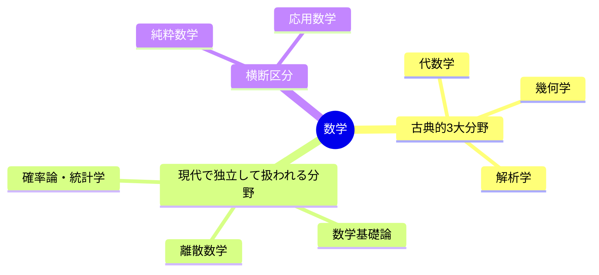

# Math

## 数学とは

数・量・図形・構造・変化といった抽象的な概念を、記号と論理を使って研究する学問（形式科学）。

## 分野の全体像

古典的には「代数・解析・幾何」の3大分野で整理するのが王道。
ここに確率・統計などを加えた分け方が現代では一般的だよ。

## ① 古典的3大分野

### 代数学（Algebra）：「構造」と「演算のルール」を調べる

* **数論**：整数や素数の性質（暗号技術に応用）
* **線形代数学**：ベクトルと行列（AI、3Dグラフィックスに応用）
* **抽象代数学（群論・環論・体論）**：対称性や計算のルールそのものを抽象化。ガロア理論は「5次以上の方程式に解の公式がない」ことの説明にもなった

### 解析学（Analysis）：「変化」と「連続性」を調べる

* **微分積分学**：変化の割合、面積・体積
* **微分方程式**：物理現象や感染症の拡大などを数式で表す
* **複素解析（複素関数論）**：虚数 *i* を含む複素数の世界での微分積分
* **実解析・測度論・関数解析**：極限や積分を厳密に扱う土台（ルベーグ積分など）。確率論の基礎にもなる

### 幾何学（Geometry）：「図形」と「空間」を調べる

* **ユークリッド幾何学**：学校で習う、平らな空間の図形
* **非ユークリッド幾何学**：双曲幾何・楕円幾何など、平行線の性質が違う空間
* **微分幾何学**：曲がった空間を微分で研究（**一般**相対性理論に応用）
* **トポロジー（位相幾何学）**：切ったり貼ったりせず、伸ばしたり縮めたりしても変わらない性質を研究（「ドーナツとコーヒーカップは同じ」）

## ② 現代で独立して扱われる分野

### 確率論・統計学：「不確実性」と「データ」を調べる

* **確率論**：偶然の出来事の法則性。1933年にコルモゴロフが測度論で公理化した
* **統計学**：大量のデータから特徴や傾向を導く（データサイエンス、機械学習の基盤）

### 数学基礎論：「数学そのものの土台」を調べる

* 論理学・集合論・証明論・計算可能性理論
* ゲーデルの不完全性定理（1931年）もここ

### 離散数学：「とびとびの対象」を調べる

* グラフ理論、組合せ論、アルゴリズムの数理
* 情報科学との相性が特に良い

## ③ 純粋数学と応用数学

| 区分 | 目的 | 例 |
|---|---|---|
| 純粋数学 | 数学自体の構造を探究 | 数論、トポロジー、抽象代数 |
| 応用数学 | 現実の問題を数理で解く | 数値解析、最適化、情報理論（シャノン、1948年） |

※ 確率・統計は応用数学に分類されることも多い。分け方は流派によって変わるよ。

<!-- index:start (auto-generated by .scripts/gen_index.py: この範囲は上書きされます) -->

## このフォルダの中身

### サブトピック

- [微分学習ガイド](./differentiation/README.md)
- [exponential-func](./exponential-func/README.md)
- [積分 (Integration)](./integral/README.md)
- [latex](./latex/README.md)
- [対数の世界へようこそ！ 🔑](./logarithm/README.md)
- [行列](./matrix/README.md)
- [probability](./probability/README.md)
- [目次](./trigonometric-func/README.md)
- [vector](./vector/README.md)

<!-- index:end -->
